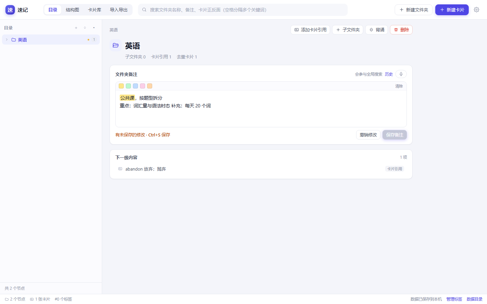
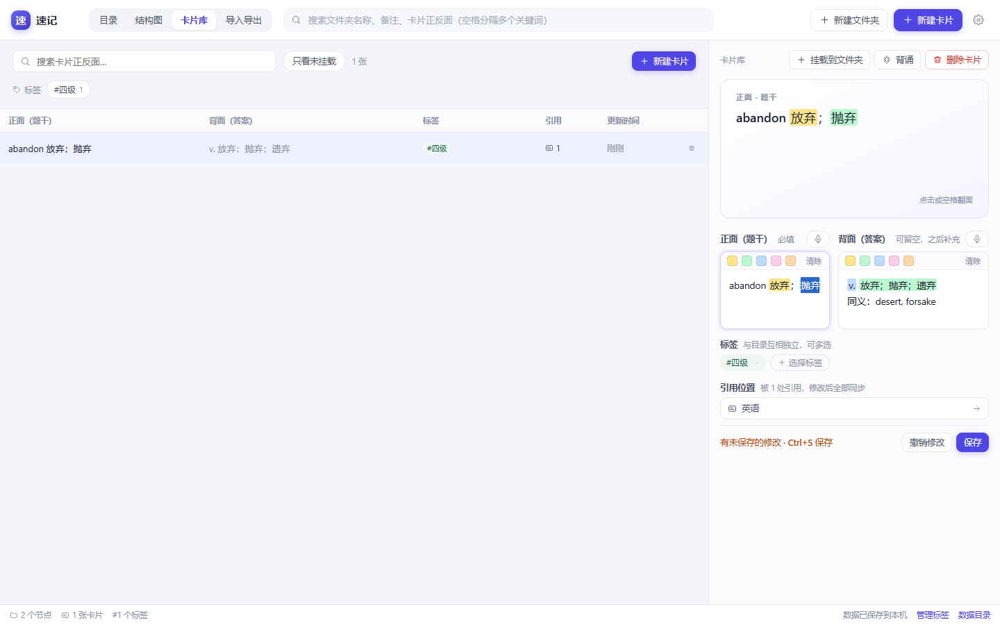
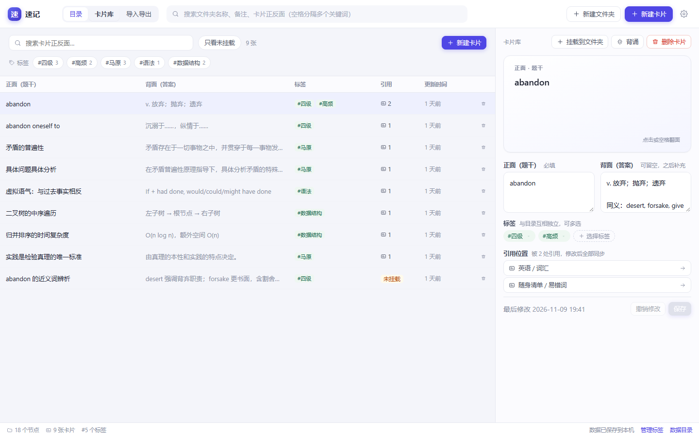
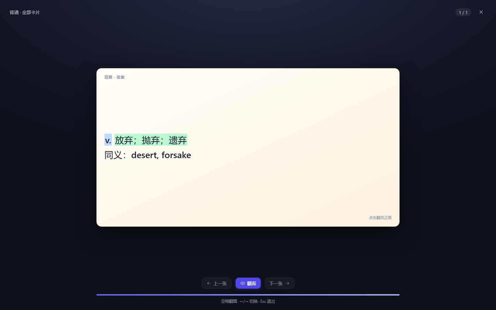
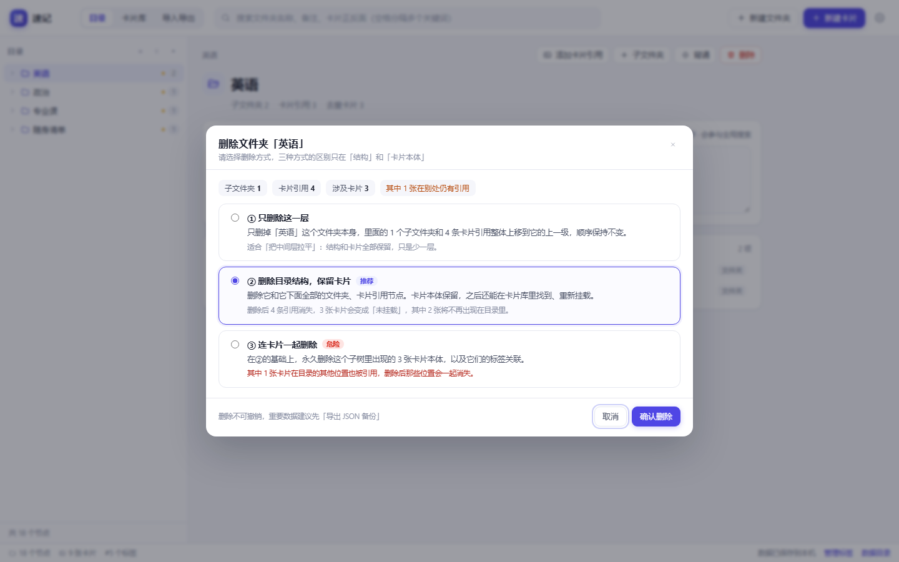
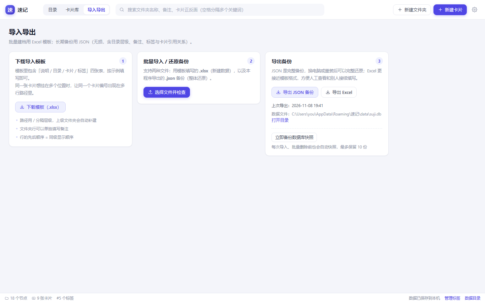
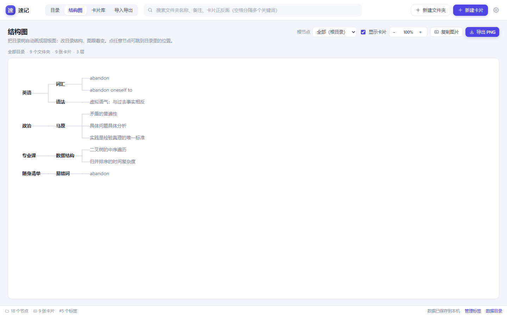
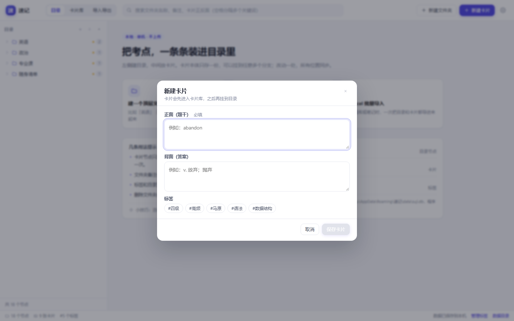
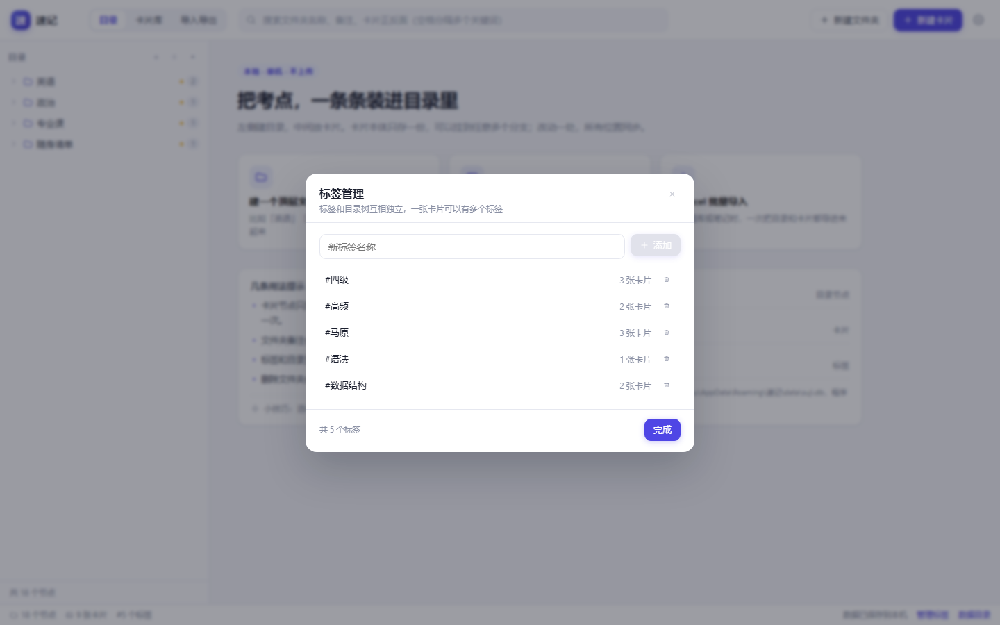

# 速记 · 个人备考记忆知识库

> 面向专升本 / 考证备考者的**本地单机**知识卡片工具。目录负责结构，标签负责串联，卡片本体只存一份、可挂到任意多个分支，改一处、处处同步。



---

## 一、功能一览

| 模块 | 已实现能力 | 对应需求 |
| --- | --- | --- |
| 树形目录 | 新建文件夹（可带备注）、新建卡片引用、拖拽调整层级与顺序、重命名、编辑备注、三种删除策略 | F001–F005 |
| 卡片管理 | 新建 / 编辑 / 删除卡片本体；卡片与目录解耦；删除后所有引用自动消失 | F006–F008 |
| 标签 | 标签库增删改、卡片多标签、按标签筛选（默认"同时满足"，可切换"任一满足"） | F009–F011 |
| 导入导出 | 下载 Excel 模板、批量导入（预检 + 错误行提示 + 追加/覆盖 + 同正面复用）、导出 JSON / Excel、JSON 整体还原 | F012–F013 |
| 全局检索 | 检索文件夹名、文件夹备注、卡片正反面；多关键词空格取交集；结果按卡片聚合、附引用路径、点击定位到树 | F014 |
| 背诵预览 | 3D 翻转卡、按文件夹生成背诵队列、进度、键盘操作、全屏遮罩 | F015 |
| 结构图 | 把任意文件夹的子树自动画成「左→右、方括号连接」的层级图，可缩放、导出 PNG、复制图片、点击节点跳回目录 | 自选增强 |
| 语音输入 | 卡片正反面、文件夹备注旁加麦克风按钮，点击即可语音转文字，说完停顿自动上屏 | 自选增强 |
| 画重点 | 选中卡片正反面、文件夹备注里的文字后点颜色（黄/绿/蓝/粉/橙）即可高亮，背诵和预览时保留；同一段可换色或清除 | 自选增强 |
| 历史版本 | 每次保存前自动留一份旧内容（每字段保留 20 版），列表用红/绿标出与当前内容的差异，误删可一键回退；备注与卡片都改为手动保存 | 自选增强 |

额外补充：删除前的子树预扫描统计、自动数据库快照、孤儿卡片（未挂载）提示、卡片"引用位置"面板。

---

## 二、运行

### 便携版（推荐，本机用的就是它）

双击 **`启动速记.bat`**。

- 自带 Node 运行时（`runtime\node.exe`），**不需要安装 Node.js，也不依赖 Electron**；
- 启动一个本地服务，再用系统自带 Edge 的**无地址栏应用窗口**打开界面，看起来就是个独立软件；
- 任务栏里会出现一个名为「速记服务」的最小化窗口，**关掉它才是真正退出**；
- 重复双击不会开第二个实例，会复用已在运行的那个；
- 数据默认在 `%APPDATA%\速记\data\suji.db`，不可写时自动落到本目录的 `data\`。

打包好的干净副本（不含任何个人数据）在 `dist\速记-便携版.zip`，解压即可用、可发给别人。

从 GitHub 直接下载：[**Releases**](https://github.com/xinyoumushi/suji/releases/latest) → `suji-1.0.0-portable-win-x64.zip`，解压后双击 `启动速记.bat` 即可。

### 桌面版（Electron 窗口，可选）

源码里保留了 Electron 入口，用 `pnpm build` 构建后执行 `npx electron .` 即可。

> ⚠️ 本机实测：Electron 运行时（31/38/41/45 均已验证）在启动瞬间被系统拦截，退出码 `0x80000003`，连 `electron.exe --version` 都不输出。所以这台机器上只能用便携版；换到其他电脑桌面版通常正常。

### 从源码重新构建（需要 Node.js 20+）

```bash
pnpm install     # 安装构建依赖（会下载 Electron 与打包工具）
pnpm build       # 构建界面与本地服务到 out/
node scripts/build-server.mjs   # 单独重建本地服务（打包用）
```

> 便携版不依赖 Electron；只有重建产物时才需要 `pnpm install`。

### 其他脚本

```bash
pnpm typecheck   # TypeScript 类型检查（主进程 + 渲染进程）
pnpm test        # 数据层 70 项自动化检查（建树/多引用/三策略删除/标签/检索/导入导出/备份）
pnpm template    # 重新生成根目录下的「导入模板.xlsx」
```

---

## 三、界面

### 主界面（目录视图）

左：目录树；右：文件夹详情（名称、备注、下级内容）或卡片详情。

文件夹备注也是富文本：可以给重点上色、用麦克风听写，改动会自动保存并参与全局搜索。


### 卡片详情

翻转预览 + 正反面编辑 + 标签 + 引用位置（点击可直接跳到对应目录节点）。

编辑框上方的五个色块就是「画重点」：选中文字 → 点颜色 → 立刻高亮；点「清除」去掉；同一段文字换色会替换而不是叠加。



### 历史版本 / 撤回到上一版

卡片右下角的「历史版本」、文件夹备注旁的「历史」都能打开版本列表：

- 每次点保存**之前**，系统先把旧内容留一份（备注也改成手动保存了，不再自动覆盖）；
- 每条记录显示：字段（正面/背面/备注）、**多久以前**、**多少字**、以及一句「删 N · 增 M」；
- 内容用颜色直接对比当前版本：<span style="color:#b42318">红色带删除线</span> = 这一版有、现在没了；<span style="color:#067647">绿色</span> = 这一版没有、现在多了；
- 点「恢复这一版」→ 只填回编辑框，不会直接落库，确认后再点保存；
- 每处内容最多保留 20 版，删卡片/文件夹时自动清理；
- 编辑框内 `Ctrl + Z` 仍可撤销刚才的输入，`Ctrl + S` 保存。

### 卡片库

全部卡片的总表，支持搜索、标签筛选、只看未挂载；右侧是同款详情面板。



### 背诵模式

选中文件夹点「背诵"，会把该文件夹（含子文件夹）里的卡片按树顺序串成队列。



### 删除文件夹（三策略）

删除前先统计子树规模，三种策略的后果写在选项里；"连卡片一起删"必须勾选确认才能提交。



### 导入导出



### 结构图

选中任意文件夹作为根，自动生成层级图；改目录即变，可导出 PNG 或直接复制图片贴进笔记。



### 语音输入

卡片正面 / 背面、文件夹备注的标签右侧都有一个麦克风按钮：

- 点一下开始听写（按钮变红并出现小圆点），再点一下停止；
- 说完一句话停顿一下，文字会自动接到输入框末尾，中英文混排会自动补空格；
- 同一时刻只会有一个麦克风在工作，切换字段时会自动接管；
- 用的是 Edge / Chrome 内置的语音识别，**需要联网**；没麦克风、权限被拒、服务连不上都会明确提示原因；
- 如果所在的浏览器不支持（比如桌面版 Electron），可以用 <kbd>Win</kbd> + <kbd>H</kbd> 调出系统听写，效果一样。

### 新建卡片 / 标签管理




---

## 四、数据存储

| 项目 | 位置 |
| --- | --- |
| 数据库 | `%APPDATA%\速记\data\suji.db`（SQLite，WAL 模式） |
| 自动快照 | `%APPDATA%\速记\backups\`，最多保留 10 份 |
| 导出文件 | 由你在保存对话框中选择位置 |

- 所有写操作都在事务中完成；批量导入、清空后导入、连卡片删除等高风险操作**执行前会自动生成快照**。
- 每次启动若距上次备份超过 24 小时，也会自动快照一次。
- 换电脑：`导出 JSON 备份` → 新机器安装后`导入 → 选择该 JSON`，目录层级、备注、标签、多引用关系原样还原。
- 数据库是标准 SQLite 文件，可用任意 SQLite 工具直接查看。

### 数据模型（5 张表）

```
cards(id, front, back, source, created_at, updated_at)
tags(id, name, created_at)
card_tags(card_id, tag_id)                     -- 卡片 ↔ 标签 多对多
tree_nodes(id, parent_id, node_type, name, note, card_id, sort_order, ...)
                                               -- 一棵树：文件夹 或 卡片引用
app_settings(key, value)
```

关键点：

- **卡片本体与树解耦**：`tree_nodes.card_id` 只是一个引用。同一张卡可被多行引用 → 多分支挂载；改卡片只改 `cards` 一行 → 所有位置同步。
- **卡片引用节点不能有子节点**：数据库触发器 + 服务层双重拦截，导入也无法绕过。
- **删除语义**：删卡片 → 外键级联清掉它所有引用与标签关联；删文件夹 → 只动 `tree_nodes`，卡片默认保留（可能变成"未挂载"）。
- **排序**：同级 `sort_order` 步长 1024，拖拽后整体重排，简单可靠；子树/祖先链用递归 CTE 现算，不冗余存路径。

---

## 五、导入模板

根目录 `导入模板.xlsx` 与应用内「下载模板」生成的文件完全一致，含 4 张工作表：

| 工作表 | 列 | 说明 |
| --- | --- | --- |
| 说明 | — | 填写规则 |
| 目录 | 路径 / 类型 / 卡片编号 / 备注 | 每行一个节点。`类型` 只能填「文件夹」或「卡片」；文件夹行的备注会写入文件夹 |
| 卡片 | 编号 / 正面 / 背面 / 标签 | 编号仅在本文件内关联用 |
| 标签 | 标签名称 | 可留空，卡片表里用到的标签会自动创建 |

规则：

1. **路径用 `/` 分隔层级**，例如 `英语/词汇/abandon`。上级文件夹不必单独写行，系统会自动补建。
2. **行的先后顺序 = 同级显示顺序**。
3. **多引用**：让同一个「卡片编号」出现在多行不同路径里，导入后就是一张卡片、多处挂载。
4. 目录最多 10 层，单个名称 ≤100 字，卡片正反面各 ≤10000 字。
5. 导入前会先做格式检查：路径非法、编号缺失/重复、引用不存在、同路径重复挂同一张卡等都会**按行号 + 列名**提示，可修正后重新导入。

---

## 六、快捷键

| 快捷键 | 作用 |
| --- | --- |
| `Ctrl + F` | 聚焦全局搜索 |
| `Ctrl + S` | 保存当前卡片的修改 |
| `Space` | 背诵时翻面 |
| `← / →` | 背诵时上一张 / 下一张 |
| `Esc` | 关闭弹窗 / 退出背诵 / 收起搜索 |
| `双击文件夹名` | 重命名 |
| `双击卡片` | 打开卡片详情 |

---

## 七、关键流程

**删除文件夹**：右键或详情页「删除」→ 预扫描（子文件夹数 / 卡片引用数 / 去重卡片数 / 其中在别处仍被引用的数量）→ 三选一：

1. **只删这一层**：子节点整体上移到父级，结构与卡片全保留；
2. **删结构保卡片**（默认）：子树内的文件夹与引用删除，卡片本体保留（可再次挂载）；
3. **连卡片一起删**（危险）：删除子树内所有卡片本体及其全部引用，需勾选确认，执行前自动快照。

**搜索定位**：输入即搜（240ms 防抖）→ 结果分「文件夹 / 卡片」两组，卡片按卡片聚合、显示引用处数 → 点击结果自动展开祖先节点、滚动到目标、高亮闪烁，右栏同步展示；命中备注时会带上下文片段。

**导入**：选择文件 → 预检并展示统计与错误 → 选择追加/覆盖与"同正面复用" → 单事务提交 → 结果汇总。

---

## 八、目录结构

```
速记/                        ← 双击「启动速记.bat」即可使用
├── 启动速记.bat             # 启动器：拉起本地服务 + 打开 Edge 应用窗口
├── runtime/node.exe         # 自带 Node 运行时（不需要安装 Node.js）
├── out/
│   ├── server/              # 本地服务（已打包 exceljs，无外部依赖）
│   └── renderer/            # 界面构建产物
├── data/                    # 你的数据与运行期文件（不会被放进 dist 压缩包）
├── backups/                 # 自动数据库快照
├── 导入模板.xlsx             # 配套导入模板
├── 使用说明.txt              # 给使用者看的简短说明
├── dist/速记-便携版.zip      # 干净的可分发副本（不含任何个人数据）
├── docs/screenshots/        # README 配图
├── src/                     # 源码（主进程 / 本地服务 / 渲染层）
├── scripts/                 # 构建脚本（构建服务端、生成模板、数据层自检）
└── README.md
```

便携版运行时只需要 `启动速记.bat` + `runtime` + `out` 三样东西；`data` 属于使用者自己。

> 源码仓库**不含** `runtime/`、`out/`、`dist/`（Node 运行时与构建产物）。克隆后按上文「从源码重新构建」生成即可；`dist/速记-便携版.zip` 请从 [Releases](https://github.com/xinyoumushi/suji/releases/latest) 下载。

---

## 九、常见问题

**第一次运行提示「Windows 已保护你的电脑 / 此应用可能对计算机有害」？**

这是 SmartScreen 对「下载来的、没有数字签名的程序」的常规拦截，不是病毒：

- 解压**之前**右键压缩包 → 属性 → 勾选「解除锁定」→ 确定，再解压，之后就不会再提示；
- 已经解压了也没关系：第一次双击 `启动速记.bat` 会自动清除程序文件夹的「下载」标记，弹窗选「更多信息 → 仍要运行」一次即可；
- 想彻底消除只能给程序做代码签名（个人使用没必要）。


**数据存在哪里？会不会丢？**
`%APPDATA%\速记\data\suji.db`，关闭程序后仍在。系统在每天首次启动、导入前、批量删除前自动生成快照，最多保留 10 份，可在「设置 → 立即备份」手动生成。

**浏览器模式下怎么关闭程序？**关掉界面窗口后，任务栏里还有一个名为「速记服务」的最小化窗口，关闭它才算真正退出（否则服务仍在后台占着 45871 端口）。下次启动会自动复用或换端口，不会冲突。

**浏览器模式和数据会不会和桌面版打架？**
两者读写的是同一个 `suji.db`，可以先在浏览器版里用，之后换成桌面版也无缝衔接。只是不建议两边同时开着编辑同一份数据。

**双击启动器后什么都没发生？**
打开 `%APPDATA%\速记\startup.log`：
- 文件不存在 → Electron 进程还没跑起来就退出了（多见于系统拦截或环境变量干扰，启动器已尝试规避 `ELECTRON_RUN_AS_NODE`）；
- 有"启动失败"记录 → 按里面的错误信息处理，通常和文件权限有关；
- 有"renderer 加载失败"→ 构建产物不完整，重新执行 `pnpm build`。

**想换电脑 / 重装系统怎么办？**
「导入导出 → 导出 JSON 备份」，新环境安装后「批量导入 / 还原备份」选择该 JSON，数据完整还原。

**卡片在卡片库里，但目录里找不到？**
它处于「未挂载」状态（常见于删除文件夹时选了"删结构保卡片"）。在卡片详情点「挂载到文件夹」，或在卡片库勾选"只看未挂载"批量处理。

**导入时提示某行错误怎么办？**
按提示的"工作表 + 行号 + 列名"修改后重新导入；有错误时默认不允许导入，避免半成品数据。

**能不能直接用 Excel 编辑已导出的数据？**
可以。导出的 Excel 与模板同结构，改完再导入即可（建议先用"清空后导入"或先备份）。

---

## 十、已知限制

- 单机使用，不做账号与云同步。
- 目录层级上限 10 层（防止误操作把树拉得过深）。
- 导入仅支持 `.xlsx`（模板）与 `.json`（本程序备份）。
- 删除不进入回收站，依赖自动快照兜底；如需回收站可作为后续版本增强。
- 语音输入依赖浏览器在线的语音识别服务，离线时不可用（可退回系统听写 Win+H）。
- 画重点保存在卡片内容里，JSON 备份/还原完整保留；导出 Excel 时只保留纯文本（单元格无法表达行内高亮）。
- 复习算法、刷题、错题统计为后续扩展方向，当前版本未包含。
